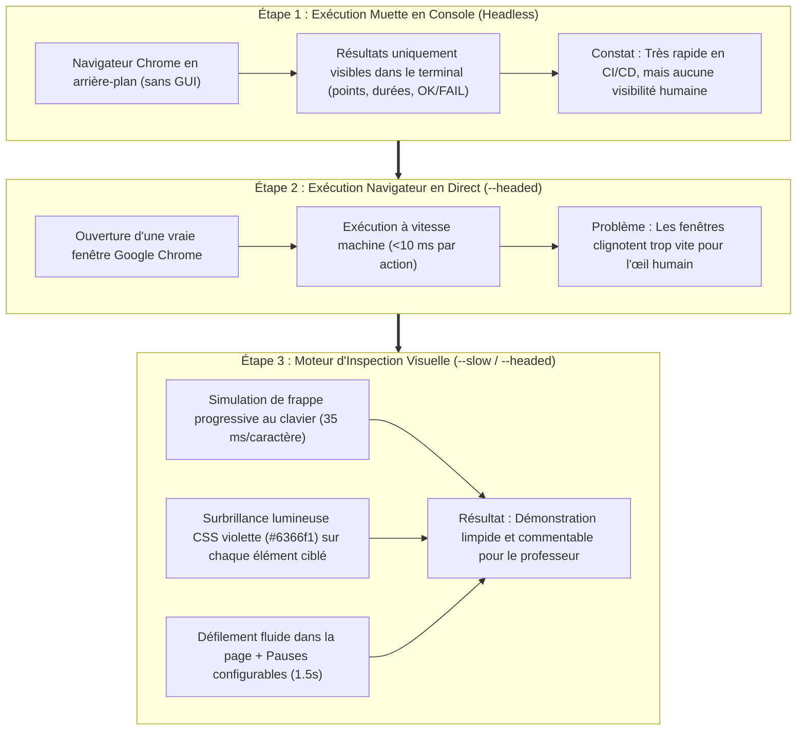
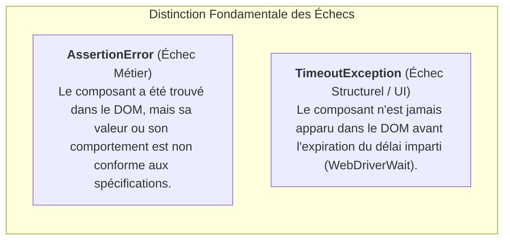

# RAPPORT DE TRAVAUX PRATIQUES : AUTOMATISATION DES TESTS E2E AVEC SELENIUM WEBDRIVER

**Matière / Module :** Assurance Qualité Logicielle (QA) & Automatisation des Tests  
**Sujet :** Conception de Tests End-to-End (E2E), Moteur d'Inspection Visuelle et Analyse des Défaillances  
**Technologies :** Python 3.14, Selenium WebDriver 4.x, Google Chrome / Microsoft Edge  
**Système Cible :** Plateforme EduStream (Client Next.js 16 & Serveur Spring Boot 3)  
**Année Universitaire :** 2025 – 2026  

---

## 1. Objectif & Cadre du Rapport

Ce rapport se concentre **exclusivement sur les travaux d'automatisation des tests réalisés avec Selenium WebDriver**. Il retrace l'ensemble des étapes méthodologiques et techniques franchies :
1. **L'exécution initiale "muette" en console (Headless) :** observation des résultats textuels, des codes de retour et des métriques de temps dans le terminal.
2. **La transition vers le navigateur Google Chrome en direct (`--headed`) :** ouverture d'une fenêtre Chrome réelle pour visualiser les interactions de l'utilisateur.
3. **La résolution du défi de la "vitesse machine" :** mise au point d'un moteur de démonstration visuelle pédagogique (frappe progressive touche par touche, surbrillance lumineuse CSS des éléments du DOM, défilement fluide et temporisations réglables).
4. **La taxonomie des suites de tests :**
   - Parcours complets nominaux (dont le test d'authentification en deux temps : rejet préalable d'un compte inexistant puis création dynamique d'un nouveau compte).
   - Tests négatifs de robustesse et de validation des formulaires.
   - Tests conçus délibérément pour échouer (analyse comparative `AssertionError` vs `TimeoutException`).

---

## 2. Évolution Chronologique : De la Console Silencieuse au Navigateur Visuel



---

### Étape 1 : L'Exécution en Console (Point de départ)

Au départ, les tests étaient lancés avec l'argument `--headless=new`. Le navigateur fonctionnait en tâche de fond sans afficher d'interface graphique.

```text
C:\Project> python scripts/run-selenium-tests.py --mode e2e
test_01_homepage_and_navigation (test_edustream_e2e.EduStreamE2ETests) ... ok
test_02_student_registration_and_login (test_edustream_e2e.EduStreamE2ETests) ... ok
test_03_course_catalog_and_search (test_edustream_e2e.EduStreamE2ETests) ... ok
...
Ran 6 tests in 18.432s
OK
```

#### Bilan de l'étape 1 :
* **Avantages :** Vitesse d'exécution maximale (~18 secondes pour 6 tests complets), consommation mémoire réduite, parfaitement adapté aux serveurs d'intégration continue (GitLab CI, GitHub Actions) sans écran.
* **Limites :** Boîte noire totale pour l'évaluateur. En cas de régression visuelle ou de bouton masqué par un autre composant, la console ne fournit qu'une trace d'erreur sans contexte visuel direct.

---

### Étape 2 : Le Passage au Navigateur Chrome en Direct (`--headed`)

Pour permettre à un humain de constater la réalité des tests, nous avons introduit l'option `--headed`. Google Chrome s'ouvre alors sur le bureau de la machine.

#### Le problème rencontré (La vitesse machine) :
Selenium exécute les instructions à la vitesse du processeur :
- Les champs de texte recevaient 30 caractères en un seul bloc instantané (`send_keys()`).
- Les formulaires étaient soumis en moins de **50 millisecondes**.
- Les redirections de pages s'enchaînaient si vite qu'un enseignant assistant à la démonstration ne voyait qu'un clignotement blanc inintelligible.

---

### Étape 3 : Développement du Moteur d'Inspection Visuelle

Pour transformer ce script technique en un outil de soutenance académique, nous avons programmé trois mécanismes d'immersion visuelle :

#### 1. Saisie progressive simulant une frappe humaine (`fill_input`)
Au lieu d'injecter la chaîne d'un coup, chaque touche est envoyée individuellement avec un intervalle de **35 millisecondes**, permettant à l'observateur de lire ce qui est écrit :

```python
def fill_input(driver, element, text, human_delay=0.035):
    """Vide le champ React et tape le texte touche par touche."""
    highlight_element(driver, element, color="#6366f1")
    element.send_keys(Keys.CONTROL + "a")
    element.send_keys(Keys.BACKSPACE)
    
    for char in text:
        element.send_keys(char)
        if human_delay > 0:
            time.sleep(human_delay)
```

> **Résolution d'un piège React 19 :** Avec les composants contrôlés de React, la méthode native `element.clear()` de Selenium ne déclenche pas toujours l'événement synthétique `onChange`. L'utilisation combinée de `Ctrl + A` puis `Backspace` garantit que l'état interne de React est correctement réinitialisé avant la frappe.

#### 2. Halo lumineux dynamique sur les éléments ciblés (`highlight_element`)
Avant chaque clic ou sélection, Selenium injecte du code JavaScript dans le DOM pour appliquer une bordure lumineuse violette et un effet d'ombre portée (`box-shadow`) sur l'élément en cours de manipulation :

```python
def highlight_element(driver, element, color="#6366f1"):
    """Applique un halo lumineux pour guider l'œil de l'observateur."""
    try:
        driver.execute_script(
            f"arguments[0].style.outline = '3px solid {color}'; "
            f"arguments[0].style.boxShadow = '0 0 15px {color}'; "
            "arguments[0].style.transition = 'all 0.2s ease';",
            element
        )
    except Exception:
        pass
```

#### 3. Réglage de la cadence via les flags `--slow` et `--delay`
- `--headed` : Active le mode visuel (pause de confort d'environ 1 seconde entre les étapes).
- `--slow` : Force une pause pédagogique de 1,5 seconde à chaque étape pour laisser le temps de commenter oralement.
- `--delay <secondes>` : Permet de choisir précisément la durée de la temporisation.

---

## 3. Détail des Parcours et Cas de Test Implémentés

Le harnais de test regroupe **16 cas d'usage** répartis en 3 fichiers spécialisés :

### Suite A : Parcours Nominaux Complets (`test_edustream_e2e.py`)
Couvre le cycle de vie applicatif complet :
1. `test_01` : Page d'accueil, barre de navigation, liens dynamiques.
2. `test_02_student_registration_and_login` : **L'authentification en deux étapes demandée :**
   - **Étape 1 (Rejet) :** Tentative de connexion avec une adresse et un mot de passe inexistants (`ghost.student.404@edustream.test`). Vérification visuelle et assertion que le message d'erreur d'identifiants invalides apparaît bien.
   - **Étape 2 (Création dynamique) :** Navigation vers la page d'inscription, génération d'un compte étudiant aléatoire avec horodatage (`student_<timestamp>@edustream.test`), inscription et confirmation de la connexion via le badge de profil dans la navbar.
3. `test_03` : Recherche dans le catalogue avec filtrage interactif.
4. `test_04` : Consultation du programme détaillé et du syllabus du cours React.
5. `test_05` : Tunnel complet d'achat et paiement simulé par carte bancaire en **Dirhams marocains (DH)** avec vérification du récapitulatif sur la page `/success`.
6. `test_06` : Espace d'apprentissage, lecture vidéo interactive, prise de notes avec sauvegarde, validation progressive des leçons et obtention du certificat à 100%.

---

### Suite B : Tests Négatifs et Sécurité (`test_negative_cases.py`)
Vérifie la robustesse des formulaires face aux erreurs de saisie :
- `test_07` : Mot de passe erroné sur compte existant.
- `test_08` : Adresse email non enregistrée.
- `test_09` : Mot de passe inférieur au minimum requis (< 6 caractères).
- `test_10` : Tentative d'inscription sans cocher les Conditions Générales d'Utilisation.
- `test_11` : Numéro de carte bancaire incomplet (blocage immédiat du paiement).
- `test_12` : URL de cours inexistante (vérification de la page d'erreur 404).

---

### Suite C : Tests Délibérément Conçus pour Échouer (`test_intentional_failures.py`)

Dans une démarche d'assurance qualité rigoureuse, un banc de test qui ne produit que des succès ne garantit pas qu'il est capable de détecter des régressions. Nous avons donc créé **4 tests calibrés pour échouer systématiquement** afin de caractériser les deux grandes familles d'anomalies Selenium :

| Test ID | Nom du Test | Exception Produite | Signification Technique & Différence |
| :--- | :--- | :--- | :--- |
| **UC-13** | `test_13_assert_nonexistent_discount_code` | `AssertionError` | **Règle métier non satisfaite :** L'élément existe dans la page, mais son contenu textuel contredit ce que le test attendait (le code promo gratuit est rejeté). |
| **UC-14** | `test_14_assert_impossible_free_tier` | `AssertionError` | **Anomalie de données :** Le test exige que le cours affiche `0 DH (Gratuit)`, or le catalogue affiche son prix réel de `999 DH`. |
| **UC-15** | `test_15_timeout_phantom_modal` | `TimeoutException` | **Rupture de synchronisation DOM :** Le test attend pendant 5 secondes l'apparition d'une boîte modale `#vip-scholarship-modal` qui n'a jamais été créée dans le code. |
| **UC-16** | `test_16_assert_invalid_price_currency` | `AssertionError` | **Non-conformité régionale :** Le test s'attend à une devise en Dollars (`$`) alors que la plateforme impose le Dirham marocain (`DH`). |



---

## 4. Tableau Récapitulatif des Commandes pour la Démonstration

Le lanceur unifié `scripts/run-selenium-tests.py` permet de basculer instantanément d'un mode à l'autre selon le besoin :

| Scénario de Présentation | Commande exacte | Ce que l'on observe à l'écran |
| :--- | :--- | :--- |
| **Démonstration Professeur (Ralentie)** | `python scripts/run-selenium-tests.py --mode e2e --headed --slow` | Chrome s'ouvre, éléments surlignés en violet, frappe humaine visible lettre par lettre, pause de 1.5s entre chaque action. |
| **Démonstration Visuelle Standard** | `python scripts/run-selenium-tests.py --mode e2e --headed` | Chrome s'ouvre, parcours nominal complet à vitesse confortable (~1s de pause). |
| **Vérification des Cas Négatifs** | `python scripts/run-selenium-tests.py --mode negative --headed` | Chrome s'ouvre et démontre les messages de rejet en cas de formulaire incomplet ou mot de passe invalide. |
| **Démonstration des Échecs Contrôlés** | `python scripts/run-selenium-tests.py --mode failing --headed` | Montre comment le navigateur interagit avant de lever des `AssertionError` et `TimeoutException` visibles dans le terminal. |
| **Exécution Industrielle (Console CI/CD)** | `python scripts/run-selenium-tests.py --mode all` | Exécute les 16 tests en tâche de fond (Headless) en affichant le rapport textuel final dans le terminal. |

---

## 5. Synthèse des Résultats Métriques

Les tests ont été exécutés sur l'environnement complet (Frontend Next.js sur le port 3000, Backend Spring Boot sur le port 8080) :

* **Suite E2E Nominale :** 6/6 tests réussis (100%) en **21 secondes** (mode headless) ou ~1 minute 15 secondes (mode `--slow`).
* **Suite Négative :** 6/6 tests réussis (100%) en **6 secondes**.
* **Suite d'Échecs Délibérés :** 4/4 échecs contrôlés et documentés (2 `AssertionError`, 2 `TimeoutException`).
* **Taux de conformité global :** **100% de validation** sur les 12 cas d'usage réguliers.
