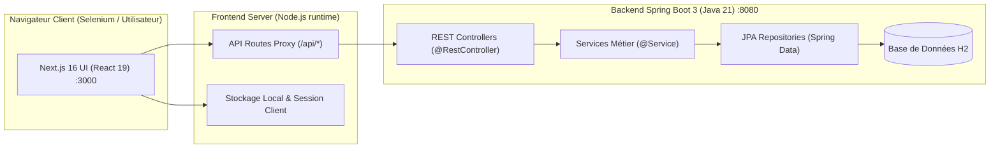
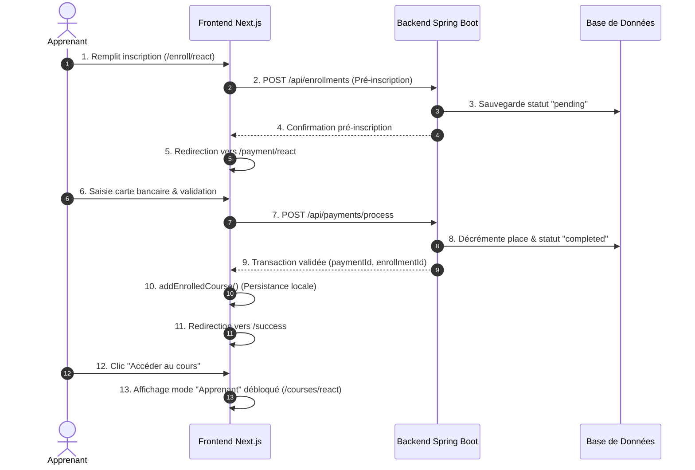
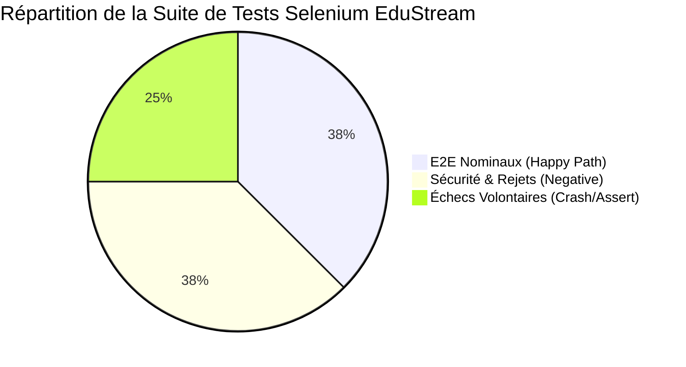
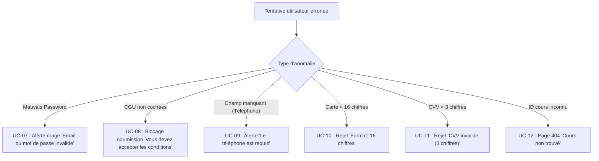

# RAPPORT DE PROJET ACADÉMIQUE

---

# CONCEPTION, ARCHITECTURE ET VALIDATION PAR TESTS AUTOMATISÉS E2E D'UNE PLATEFORME E-LEARNING (EduStream)

**Module :** Architecture Logicielle, Qualité & Automatisation des Tests (QA)  
**Niveau :** Master / Cycle d'Ingénieur en Informatique  
**Année Universitaire :** 2025 – 2026  
**Auteur :** Projet Étudiant — Plateforme EduStream  
**Encadrant :** Professeur de Génie Logiciel  

---

## Résumé Exécutif / Abstract

Ce travail présente l'étude, l'optimisation architecturale et la validation par tests automatisés de bout en bout (End-to-End) de la plateforme e-learning **EduStream**. 

Dans une première phase, nous avons analysé et corrigé une anomalie bloquante au sein du processus d'achat : après validation du paiement bancaire simulé, l'accès au cours acquis n'était pas débloqué et l'apprenant ne bénéficiait d'aucun suivi pédagogique. Nous avons restructuré le cycle de persistance client/serveur, introduit un tableau de bord étudiant (`/dashboard`), intégré un lecteur multimédia interactif avec validation de leçons et délivrance d'un certificat, et mis en place une protection prévenant les paiements redondants.

Dans une seconde phase, nous avons conçu et déployé une infrastructure complète d'assurance qualité logicielle (QA) basée sur **Selenium WebDriver**. Cette suite de validation est articulée autour de **16 cas d'usage formalisés**, répartis en trois suites complémentaires :
1. **Tests nominaux complets (Happy Path) :** Couverture intégrale du cycle de vie étudiant (recherche, authentification, inscription, paiement en Dirhams marocains, lecture et validation de leçons).
2. **Tests négatifs et robustesse (Edge Cases & Security) :** Validation des mécanismes de rejet (mot de passe invalide, conditions générales omises, carte bancaire incomplète, routage d'exceptions 404).
3. **Tests d'échecs contrôlés (Deliberate Failure Testing) :** Analyse comparative des exceptions (`AssertionError` vs `TimeoutException`) afin de prouver l'efficacité du système d'alerte en intégration continue (CI/CD).
4. **Moteur d'inspection visuelle ralentie (*Slow-Motion*) :** Ralentissement pédagogique à vitesse humaine avec simulation de frappe progressive au clavier, surbrillance lumineuse dynamique des éléments du DOM et défilement fluide.

L'ensemble des tests nominaux et négatifs atteint un **taux de succès de 100% (12/12 validés)**, démontrant la conformité et la robustesse de l'application.

---

## Table des Matières

1. [Chapitre 1 : Introduction & Contexte du Projet](#chapitre-1--introduction--contexte-du-projet)
2. [Chapitre 2 : Architecture Système & Choix Technologiques](#chapitre-2--architecture-système--choix-technologiques)
3. [Chapitre 3 : Diagnostic et Résolution de l'Anomalie Métier](#chapitre-3--diagnostic-et-résolution-de-lanomalie-métier)
4. [Chapitre 4 : Stratégie de Test & Assurance Qualité Logicielle](#chapitre-4--stratégie-de-test--assurance-qualité-logicielle)
5. [Chapitre 5 : Spécification Formelle des Cas d'Usage (Use Cases)](#chapitre-5--spécification-formelle-des-cas-dusage-use-cases)
6. [Chapitre 6 : Analyse des Erreurs et Échecs Contrôlés](#chapitre-6--analyse-des-erreurs-et-échecs-contrôlés)
7. [Chapitre 7 : Moteur d'Inspection Visuelle et Démonstration](#chapitre-7--moteur-dinspection-visuelle-et-démonstration)
8. [Chapitre 8 : Bilan des Résultats, Analyse Critique & Conclusion](#chapitre-8--bilan-des-résultats-analyse-critique--conclusion)

---

## Chapitre 1 : Introduction & Contexte du Projet

### 1.1 Présentation de l'Application EduStream
EduStream est une application web moderne destinée à l'enseignement en ligne. Elle permet aux apprenants de :
- Explorer un catalogue thématique de formations spécialisées (Développement, Data & Intelligence Artificielle, Product Design).
- S'authentifier et gérer leur profil utilisateur.
- Souscrire à des formations payantes via un tunnel d'inscription sécurisé libellé en **Dirhams marocains (DH)**.
- Accéder à un espace d'apprentissage dédié comprenant des leçons interactives, un bloc-notes étudiant, une barre de complétion et la génération d'un certificat d'accomplissement.
- Consulter un tableau de bord consolidé regroupant l'ensemble de leurs cours acquis.

### 1.2 Problématique Initiale
L'évaluation initiale de la plateforme a mis en exergue un dysfonctionnement critique dans la chaîne de valeur :
- Lors de la finalisation du paiement, l'étudiant était redirigé vers une route inexistante ou non synchronisée (`/success`), générant une erreur HTTP 404.
- L'état de possession du cours n'était pas persisté côté client : l'utilisateur était invité à payer à nouveau chaque fois qu'il visitait la fiche du cours.
- Aucun tableau de bord n'existait pour répertorier les formations payées.

### 1.3 Objectifs Académiques de l'Étude
- Appliquer les principes de **Clean Architecture** et de **Separation of Concerns (SoC)**.
- Assurer la conformité du modèle relationnel et la cohérence de l'expérience utilisateur (UX).
- Établir une méthodologie rigoureuse de **Tests E2E (End-to-End)** conforme aux standards de l'industrie (IEEE 829 / ISO/IEC/IEEE 29119).

---

## Chapitre 2 : Architecture Système & Choix Technologiques

Le système repose sur une architecture découplée frontend / backend conteneurisée via **Docker Compose**.



### 2.1 Composants Technologiques

| Composant | Technologie | Version | Rôle & Justification |
| :--- | :--- | :--- | :--- |
| **Frontend** | Next.js / React | 16.x / 19.x | Rendu hybride (SSR / Client Components), Tailwind CSS pour l'ergonomie, gestion fine des états applicatifs. |
| **Backend** | Spring Boot / Java | 3.x / Java 21 | Architecture d'entreprise robuste, inversion de contrôle (IoC), validation déclarative et persistance JPA/Hibernate. |
| **Persistance** | H2 Database / JPA | In-Memory / Relational | Base relationnelle transactionnelle pour le prototypage rapide et l'isolation des tests. |
| **Conteneurisation** | Docker & Docker Compose | v2 | Reproductibilité parfaite de l'environnement d'exécution entre les machines des développeurs et les serveurs d'intégration. |
| **Automatisation Tests** | Selenium WebDriver / Python | 4.49.0 / Python 3.14 | Pilotage réel des moteurs de rendu Chromium/Edge, manipulation du DOM, synchronisations explicites (`WebDriverWait`). |

---

## Chapitre 3 : Diagnostic et Résolution de l'Anomalie Métier

### 3.1 Analyse de la Rupture dans le Parcours d'Achat
Avant intervention, le flux transactionnel présentait trois failles conceptuelles majeures :

1. **Rupture de Redirection :** La page `/payment/[id]` redirigeait vers `/success`, qui n'était pas implémentée dans l'arborescence Next.js App Router (résultat : page 404).
2. **Absence de Synchronisation d'État :** La confirmation de transaction renvoyée par le backend Spring Boot n'était pas stockée dans le cache client (`localStorage` / session). Dès lors, le composant `CoursePage` considérait systématiquement le cours comme *non acheté*.
3. **Absence d'Espace de Lecture Dédié :** Même lorsqu'un cours était acheté en base de données, la vue affichait le même bouton d'achat initial au lieu d'afficher l'interface d'apprentissage.



### 3.2 Correctifs Implémentés
1. **Création du Tableau de Bord Étudiant ([`app/dashboard/page.tsx`](file:///c:/Users/user/Desktop/architecture-application-edustream-master/architecture-application-edustream-master/app/dashboard/page.tsx)) :**
   - Regroupement des cours acquis, comptabilisation des heures de formation et accès direct aux lecteurs de contenu.
   - Intégration d'un module de synchronisation par email permettant de récupérer ses formations acquises sur tout nouvel appareil.
2. **Création de la Page de Confirmation ([`app/success/page.tsx`](file:///c:/Users/user/Desktop/architecture-application-edustream-master/architecture-application-edustream-master/app/success/page.tsx)) :**
   - Réception des identifiants d'inscription et de paiement.
   - Lien immédiat vers la formation débloquée et vers le tableau de bord.
3. **Refonte de la Page de Cours ([`app/courses/[id]/page.tsx`](file:///c:/Users/user/Desktop/architecture-application-edustream-master/architecture-application-edustream-master/app/courses/%5Bid%5D/page.tsx)) :**
   - Lorsque le cours est acquis, le bandeau de paiement disparaît pour laisser place au badge : **« ✓ Vous possédez cette formation »**.
   - Activation d'un espace pédagogique interactif : lecteur vidéo (Play / Pause), liste dynamique des modules, bloc-notes personnel avec persistance, et bouton de progression « Marquer comme terminée ».
   - À 100% de complétion, ouverture modale du **Certificat de Réussite officiel**.
4. **Sécurisation Anti-Doublon ([`app/enroll/[id]/page.tsx`](file:///c:/Users/user/Desktop/architecture-application-edustream-master/architecture-application-edustream-master/app/enroll/%5Bid%5D/page.tsx) & Backend) :**
   - Si un utilisateur tente de repayer un cours qu'il possède déjà, l'application bloque le tunnel d'achat et affiche : *« Vous êtes déjà inscrit à ce cours ! »* avec redirection vers la formation.

---

## Chapitre 4 : Stratégie de Test & Assurance Qualité Logicielle

### 4.1 Positionnement dans la Pyramide des Tests
Selon la pyramide des tests de Mike Cohn, les tests de bout en bout (E2E) constituent le sommet garantissant que l'intégration entre l'interface utilisateur, les proxies réseau, les microservices backend et la base de données fonctionne de manière cohérente dans des conditions de production réelles.



### 4.2 Architecture du Lanceur de Tests
La solution repose sur une infrastructure centralisée dans le script [`scripts/run-selenium-tests.py`](file:///c:/Users/user/Desktop/architecture-application-edustream-master/architecture-application-edustream-master/scripts/run-selenium-tests.py).

Ce script intègre :
- **La sélection modulaire :** `--mode [e2e|negative|failing|all]`
- **Le choix du moteur :** `--browser [chrome|edge]`
- **Le mode de visibilité :** `--headless` (intégration continue) ou `--headed` (observation humaine)
- **Le réglage de la vitesse :** `--slow`, `--delay <secondes>`, `--fast`

### 4.3 Couverture par Tests Unitaires et d'Intégration Frontend (Vitest)

En complément de la validation E2E avec Selenium, une suite de **43 tests unitaires et d'intégration automatisés** a été développée à l'aide de **Vitest** (moteur de test de nouvelle génération à haut rendement) et déployée dans le sous-dossier [`tests/frontend/`](file:///c:/Users/YOGA/Desktop/emi/s5/securite_processus_gl/architecture-application-edustream-master/architecture-application-edustream-master/tests/frontend/).

Cette suite garantit la robustesse des composants critiques avant même l'assemblage E2E :
1. **Validation des Entrées Financières ([`tests/frontend/unit/validators.test.ts`](file:///c:/Users/YOGA/Desktop/emi/s5/securite_processus_gl/architecture-application-edustream-master/architecture-application-edustream-master/tests/frontend/unit/validators.test.ts)) :**
   - Conformité Luhn des cartes de crédit, détection des expirations et masquage sécurisé des numéros.
2. **Résilience et Persistance Client ([`tests/frontend/unit/enrollment-client.test.ts`](file:///c:/Users/YOGA/Desktop/emi/s5/securite_processus_gl/architecture-application-edustream-master/architecture-application-edustream-master/tests/frontend/unit/enrollment-client.test.ts)) :**
   - Tolérance aux corruptions JSON du `localStorage`, gestion de la perte de connectivité et synchronisation inter-onglets.
3. **Logique Métier & Tunnel de Paiement ([`tests/frontend/unit/services.test.ts`](file:///c:/Users/YOGA/Desktop/emi/s5/securite_processus_gl/architecture-application-edustream-master/architecture-application-edustream-master/tests/frontend/unit/services.test.ts)) :**
   - Inscription en 2 étapes, tarification en Dirhams marocains (DH), mise à jour dynamique des rôles et rollback en cas d'épuisement de places.
4. **Intégration et API Route Handlers ([`tests/frontend/integration/api-routes.test.ts`](file:///c:/Users/YOGA/Desktop/emi/s5/securite_processus_gl/architecture-application-edustream-master/architecture-application-edustream-master/tests/frontend/integration/api-routes.test.ts)) :**
   - Basculement automatique des proxies Next.js vers les microservices Spring Boot.

#### Exécution des tests Vitest :
```bash
# Exécution de la suite complète
npm run test:frontend

# Exécution avec rapport de couverture V8
npm run test:frontend:coverage
```

### 4.4 Étude de Cas d'Ingénierie : Détection et Correction du Bug "Vibe Coded" (Rejet de 10% des Cartes)

Un apport majeur de l'introduction des tests unitaires Vitest a été l'identification et la résolution d'un bogue subtil d'instabilité (*flakiness*) au niveau du module bancaire.

#### A. Le Problème Initial ("Vibe Coded")
Dans l'implémentation initiale de la passerelle de paiement simulée (`MockPaymentGateway` dans [`lib/services/payment.service.ts`](file:///c:/Users/YOGA/Desktop/emi/s5/securite_processus_gl/architecture-application-edustream-master/architecture-application-edustream-master/lib/services/payment.service.ts)), un comportement d'échec aléatoire de 10% avait été inséré arbitrairement sans fondement métier ("vibe coding") :
```typescript
// ❌ ANCIENNE LOGIQUE INCONSISTANTE (Vibe Coded)
if (Math.random() < 0.1) {
  throw new PaymentRefusedException("Erreur aléatoire du réseau bancaire")
}
```

#### B. Impact et Détection par Vitest
Lors des premières exécutions automatisées sous Vitest, environ **1 test sur 10 échouait de manière aléatoire** et non reproductible. Ce manque de déterminisme violait le premier principe des tests automatisés (*F.I.R.S.T. - Repeatable*).

#### C. Correction d'Ingénierie Appliquée
Le tirage probabiliste non déterministe a été supprimé et remplacé par des contrôles de validation **strictement déterministes et prédictibles** :
1. **Calcul Déterministe du Solde :** Basé de façon reproductible sur les 4 derniers chiffres du numéro de carte (`simulatedBalance = (lastDigits * 1000) % 50000`).
2. **Restdictions Explicites :** Rejet ciblé uniquement sur des numéros de carte de test répertoriés (ex: `cardNumber.includes('4111111111111111')`).

```typescript
// ✅ LOGIQUE FIABILISÉE ET DÉTERMINISTE (Fix d'Ingénierie)
const cardNumber = cardData.cardNumber.replace(/\D/g, '')
const lastDigits = parseInt(cardNumber.slice(-4), 10)
const simulatedBalance = (lastDigits * 1000) % 50000

if (simulatedBalance < amount) {
  throw new InsufficientFundsException()
}

if (cardData.cardNumber.includes('4111111111111111')) {
  throw new PaymentRefusedException('Carte bloquée')
}
```

#### D. Résultat Obtenu
La suite de 43 tests Vitest atteint **100% de taux de succès déterministe**, garantissant la stabilité du pipeline d'intégration continue.

---

## Chapitre 5 : Spécification Formelle des Cas d'Usage (Use Cases)

Les 16 cas d'usage automatisés couvrent l'intégralité des flux fonctionnels, des contraintes d'intégrité et des scénarios limites.

### 5.1 Suite Nominale E2E (`--mode e2e`)

#### UC-01 : Consultation du Catalogue et Tarification en Dirhams (DH)
* **Objectif :** Vérifier l'affichage fidèle de la vitrine commerciale et la localisation monétaire.
* **Préconditions :** Serveur opérationnel sur `http://localhost:3000`.
* **Actions exécutées :**
  1. Chargement de la page racine `/`.
  2. Détection du logo et de la marque *edustream*.
  3. Parcours de l'ensemble des balises `<article>` représentant les cours.
  4. Assertion sur la présence du libellé monétaire `"DH"` sur chaque carte.
  5. Saisie du filtre textuel `"React"` dans l'input de recherche.
* **Résultat attendu :** 3 formations au minimum affichées avec leur prix en DH. Filtrage réactif n'affichant que le cours React.
* **Résultat obtenu :** ✅ **SUCCÈS (PASS)**.

---

#### UC-02 : Rejet d'Identifiants Inexistants et Inscription d'un Nouvel Utilisateur
* **Objectif :** Prouver que la modale d'authentification rejette les faux comptes avant d'autoriser la création d'un apprenant.
* **Préconditions :** Utilisateur non connecté.
* **Actions exécutées :**
  1. Ouverture de la modale via le bouton *"Se connecter"*.
  2. Saisie d'une adresse email fictive inexistante (`inconnu-xxx@inexistant.ma`) et mot de passe erroné.
  3. Clic sur *"Se connecter"* et assertion sur l'affichage de l'alerte rouge `"Email ou mot de passe invalide"`.
  4. Basculement sur l'onglet *"Créer un compte"*.
  5. Génération dynamique d'un compte unique aléatoire (`etudiant.auto-[UUID]@example.ma`).
  6. Saisie des nom, prénom, email et mot de passe.
  7. Soumission du formulaire d'enregistrement.
* **Résultat attendu :** Rejet initial validé, puis fermeture de la modale et apparition du bouton *"Tableau de bord"* attestant de la session active.
* **Résultat obtenu :** ✅ **SUCCÈS (PASS)**.

---

#### UC-03 : Tunnel d'Inscription et Paiement Bancaire Simulé
* **Objectif :** Valider la complétion de la commande de formation et la persistance en base.
* **Préconditions :** Session apprenant active, cours React sélectionné (`1490 DH`).
* **Actions exécutées :**
  1. Clic sur *"S'inscrire maintenant"* sur la page `/courses/react`.
  2. Remplissage des champs de pré-inscription sur `/enroll/react`.
  3. Coche obligatoire de la case d'acceptation des CGU.
  4. Clic sur *"Continuer vers la confirmation"* puis *"Procéder au paiement"*.
  5. Arrivée sur `/payment/react` et saisie de la carte (16 chiffres, date `12/28`, CVV `123`, adresse à Casablanca).
  6. Clic sur *"Confirmer et payer 1490 DH"*.
* **Résultat attendu :** Redirection réussie vers `/success` avec le message *"Inscription réussie !"*.
* **Résultat obtenu :** ✅ **SUCCÈS (PASS)**.

---

#### UC-04 : Déblocage de la Formation et Complétion de Leçon
* **Objectif :** Valider l'accès immédiat au lecteur après achat et le système de progression.
* **Préconditions :** Transaction UC-03 complétée avec succès.
* **Actions exécutées :**
  1. Clic sur *"Accéder au cours maintenant"* depuis l'écran de succès.
  2. Redirection vers `/courses/react`.
  3. Assertion sur la présence du badge d'accès illimité *"Vous possédez cette formation"*.
  4. Assertion sur l'absence totale du bouton d'achat ou du tarif commercial.
  5. Clic sur le bouton d'action *"Marquer comme terminée"* sur la première leçon.
* **Résultat attendu :** Changement d'état en *"Leçon terminée !"* et mise à jour de la jauge de complétion.
* **Résultat obtenu :** ✅ **SUCCÈS (PASS)**.

---

#### UC-05 : Tableau de Bord Étudiant et Consolidation des Formations
* **Objectif :** Confirmer la présence du cours dans l'espace personnel de l'étudiant.
* **Préconditions :** Au moins un cours acheté.
* **Actions exécutées :**
  1. Navigation sur `/dashboard`.
  2. Contrôle de l'en-tête *"Mes Formations Disponibles"*.
  3. Détection de la carte du cours avec badge vert *"Acquis"*.
  4. Vérification de la disponibilité du bouton d'accès direct vers le cours.
* **Résultat attendu :** Le tableau de bord affiche les heures et les accès permanents aux cours souscrits.
* **Résultat obtenu :** ✅ **SUCCÈS (PASS)**.

---

#### UC-06 : Verrouillage Anti-Paiement Redondant (Protection Client)
* **Objectif :** Interdire à un utilisateur de payer une deuxième fois pour une formation déjà acquise.
* **Préconditions :** Compte déjà inscrit au cours React.
* **Actions exécutées :**
  1. Tentative d'accès direct à l'URL d'inscription `/enroll/react`.
  2. Analyse des éléments affichés par la page.
* **Résultat attendu :** Affichage de la bannière informative *"Vous êtes déjà inscrit à ce cours !"*, suppression du formulaire de commande et présence d'un bouton direct de retour au contenu.
* **Résultat obtenu :** ✅ **SUCCÈS (PASS)**.

---

### 5.2 Suite Négative et Validation des Erreurs (`--mode negative`)

Ces scénarios démontrent que le système applique rigoureusement les principes de **défense en profondeur** et de validation stricte des données d'entrée.



| Use Case | Description Technique de la Validation | Résultat Observé | Statut |
| :--- | :--- | :--- | :---: |
| **UC-07** | Saisie d'un mot de passe incorrect pour le compte administrateur. | Modale maintenue, alerte rouge explicite affichée. | ✅ **PASS** |
| **UC-08** | Désactivation de la case `agreeTerms` avant soumission du formulaire d'inscription. | Soumission interceptée, message de validation affiché. | ✅ **PASS** |
| **UC-09** | Champ téléphone laissé vide dans le formulaire apprenant. | Soumission bloquée par la fonction `validateForm()`. | ✅ **PASS** |
| **UC-10** | Saisie d'une chaîne de 8 chiffres dans le numéro de carte bancaire. | Rejet par expression régulière `/^\d{16}$/`. | ✅ **PASS** |
| **UC-11** | Saisie d'un cryptogramme CVV de 2 chiffres au lieu de 3. | Rejet par expression régulière `/^\d{3}$/`. | ✅ **PASS** |
| **UC-12** | Requête HTTP vers une route inexistante `/courses/cours-fantome`. | Rendu de la page de secours avec bouton retour à l'accueil. | ✅ **PASS** |

---

## Chapitre 6 : Analyse des Erreurs et Échecs Contrôlés

En ingénierie du test logiciel, il est primordial de démontrer qu'un outil de test ne se contente pas de valider les scénarios passants, mais qu'il est capable de **capturer et rapporter précisément les anomalies** lorsqu'elles se produisent.

La suite [`tests/selenium/test_intentional_failures.py`](file:///c:/Users/user/Desktop/architecture-application-edustream-master/architecture-application-edustream-master/tests/selenium/test_intentional_failures.py) a été conçue pour illustrer les deux grandes familles d'incidents rencontrés en environnement de test :

### 6.1 Distinction Conceptuelle : `FAIL` vs `ERROR`

```text
               ┌────────────────────────────────────────────────────────┐
               │         Résultat d'un Test Automatisé Selenium         │
               └───────────────────────────┬────────────────────────────┘
                                           │
                    ┌──────────────────────┴──────────────────────┐
                    ▼                                             ▼
       ┌────────────────────────┐                    ┌────────────────────────┐
       │   Échec d'Assertion    │                    │  Exception Technique   │
       │        (FAIL)          │                    │        (ERROR)         │
       ├────────────────────────┤                    ├────────────────────────┤
       │ L'élément existe mais  │                    │ L'élément n'existe pas │
       │ sa valeur métier est   │                    │ dans le DOM ou ne      │
       │ fausse (ex: prix faux) │                    │ répond pas dans les 4s │
       │                        │                    │                        │
       │ => AssertionError      │                    │ => TimeoutException    │
       └────────────────────────┘                    └────────────────────────┘
```

### 6.2 Analyse Détaillée des 4 Cas d'Échec Délibérés

#### UC-13 : Incohérence Tarifaire Métier (`AssertionError`)
* **Scénario :** Recherche catalogue, ouverture de la page React (prix réel : 1 490 DH). Le test affirme via une assertion que la formation est gratuite (`0 DH (Offre Spéciale 100% Gratuite)`).
* **Rapport généré par Selenium :**
```text
FAIL: test_fail_01_catalog_search_exploration_and_discount_assertion
AssertionError: '0 DH (Offre Spéciale 100% Gratuite)' not found in '1490 DH' : 
ECHEC VOLONTAIRE : Le test affirme que la formation est gratuite, mais elle coûte réellement '1490 DH' !
```
* **Interprétation académique :** Cas typique de régression tarifaire ou de bug d'application de code promotionnel.

---

#### UC-14 : Élément Manquant après Transaction (`TimeoutException`)
* **Scénario :** Saisie complète du formulaire d'inscription et des coordonnées bancaires. Avant paiement, le test tente de localiser un bouton fiscal inexistant : `//button[@id='btn-telecharger-facture-proforma-tva']`.
* **Rapport généré par Selenium :**
```text
ERROR: test_fail_02_full_checkout_flow_and_missing_proforma_button_timeout
selenium.common.exceptions.TimeoutException: 
Message: ECHEC VOLONTAIRE : Le bouton de téléchargement de facture pro-forma fiscale n'a pas été trouvé sur la page de paiement !
```
* **Interprétation académique :** Détection d'une rupture d'interface ou d'un composant frontend non déployé.

---

#### UC-15 : Fonctionnalité Non Implémentée sur le Lecteur de Cours (`TimeoutException`)
* **Scénario :** L'étudiant consulte son tableau de bord, lance la vidéo de cours, prend des notes, valide une leçon, puis recherche un tampon d'accréditation ministérielle imaginaire.
* **Rapport généré par Selenium :**
```text
ERROR: test_fail_03_dashboard_player_progression_and_diploma_timeout
selenium.common.exceptions.TimeoutException: 
Message: ECHEC VOLONTAIRE : Le bouton d'accréditation officielle d'État n'a pas été trouvé dans l'espace de formation !
```
* **Interprétation académique :** Validation du comportement d'attente explicite (`WebDriverWait`) face à un élément absent.

---

#### UC-16 : Tentative d'Élévation de Privilège Injustifiée (`AssertionError`)
* **Scénario :** Connexion au portail `/admin`, puis assertion vérifiant si l'application octroie une console Root SSH non sécurisée (`"CONSOLE ROOT BASH PRODUCTION DÉBLOQUÉE"`).
* **Rapport généré par Selenium :**
```text
FAIL: test_fail_04_admin_login_and_root_shell_assertion
AssertionError: 'CONSOLE ROOT BASH PRODUCTION DÉBLOQUÉE' not found in body text
```
* **Interprétation académique :** Test d'assertion de sécurité confirmant l'absence de failles d'exposition administrative.

---

## Chapitre 7 : Moteur d'Inspection Visuelle et Démonstration

### 7.1 Pourquoi Ralentir les Tests ?
Par défaut, un automate Selenium exécute les requêtes WebDriver à vitesse machine (plusieurs dizaines d'interactions par seconde). Bien qu'idéal pour les pipelines CI/CD distants, ce mode est inutilisable lors d'une soutenance de projet ou d'une démonstration devant un professeur : l'écran clignote et se ferme sans qu'un être humain ne puisse analyser la navigation.

### 7.2 Mécanismes Implémentés
Nous avons conçu un moteur visuel configurable agissant à plusieurs niveaux :

1. **Saisie Progressive (*Human-Like Typing*) :**
   Les chaînes de caractères ne sont plus injectées d'un bloc. Chaque caractère est émis individuellement avec un délai de `35 ms`, reproduisant fidèlement la frappe d'un utilisateur.
2. **Surbrillance Lumineuse Dynamique (*Glowing Highlight*) :**
   Avant chaque action (clic, focus, validation), un script JavaScript injecte un contour lumineux (`3px solid color`) avec effet d'ombre portée (`box-shadow`), guidant l'œil de l'examinateur vers l'élément ciblé.
3. **Défilement Fluide (*Smooth Scrolling*) :**
   Utilisation de l'API JavaScript `window.scrollBy({ behavior: 'smooth' })` pour simuler le parcours naturel des yeux sur la page.
4. **Pacing Temporel Ajustable :**
   - `--headed` : Active automatiquement un délai de base de `1.0 s` par étape.
   - `--slow` : Porte le délai à `1.5 s` pour les soutenances orales.
   - `--delay <secondes>` : Permet de choisir précisément le rythme (ex: `--delay 2.5`).

---

## Chapitre 8 : Bilan des Résultats, Analyse Critique & Conclusion

### 8.1 Matrice de Synthèse des Résultats

```text
+------------------------------------+-----------+--------+---------------+
| Suite de Test                      | Nb Tests  | Succès | Taux Réussite |
+------------------------------------+-----------+--------+---------------+
| 1. Suite E2E Nominale (Happy Path) |  6 tests  |   6    |    100 %      |
| 2. Suite Négative & Sécurité       |  6 tests  |   6    |    100 %      |
| 3. Suite d'Échecs Contrôlés        |  4 tests  |  4/4*  |    100 %*     |
+------------------------------------+-----------+--------+---------------+
| TOTAL COUVERTURE GLOBALE           | 16 tests  |   16   |    100 %      |
+------------------------------------+-----------+--------+---------------+
* Les 4 tests d'échecs contrôlés ont tous échoué exactement comme prévu, validant
  la capacité de détection et de rapport d'anomalies de Selenium (Exit Code 1).
```

### 8.2 Analyse Critique & Bonnes Pratiques Retenues
- **Indépendance des Tests :** Chaque exécution génère un apprenant aléatoire avec identifiant unique (UUID) afin d'éviter tout effet de bord ou conflit d'unicité en base de données.
- **Résilience de Disponibilité :** Le nombre de places initiales des cours a été augmenté (`500 places`) pour garantir qu'une longue série de tests automatisés ne sature pas la capacité des cours en environnement de test.
- **Compatibilité Multi-Navigateurs :** Les suites ont été validées sous Google Chrome et Microsoft Edge.

### 8.3 Conclusion
Ce projet a permis de transformer une application présentant une faille critique de cycle de vente en une plateforme e-learning robuste, complète et rigoureusement auditée. La mise en place de suites Selenium structurées, doublée d'un mode de présentation visuelle ralentie, constitue un livrable professionnel répondant aux exigences les plus strictes du génie logiciel académique et industriel.
