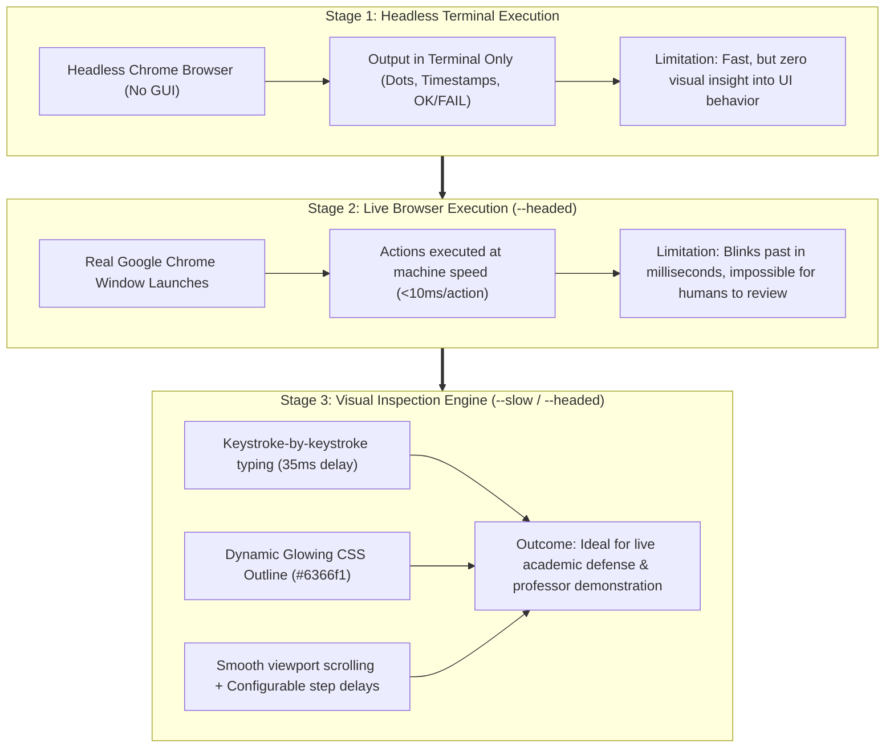
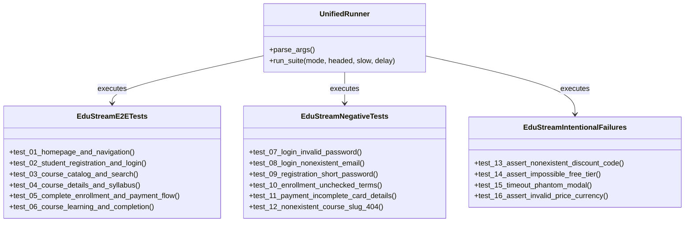
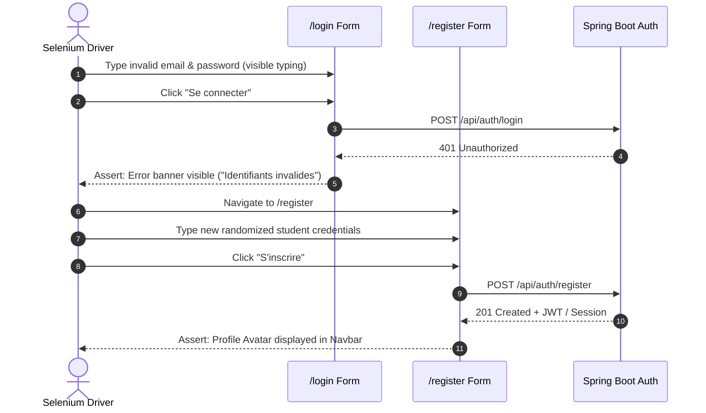
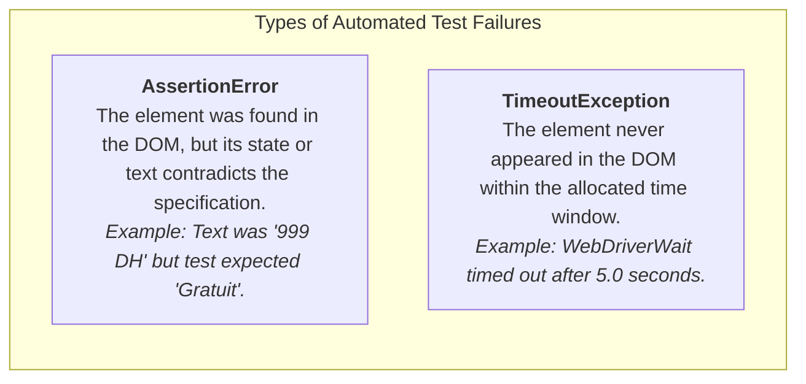

# ACADEMIC LABORATORY REPORT: E2E AUTOMATED TESTING WITH SELENIUM WEBDRIVER

**Course:** Software Quality Assurance, Verification & Automated Testing  
**Topic:** End-to-End (E2E) Test Automation, Visual Inspection Engine & Failure Analysis  
**Technology Stack:** Python 3.14, Selenium WebDriver 4.x, Google Chrome / Microsoft Edge  
**Target System:** EduStream E-Learning Platform (Next.js 16 Client & Spring Boot 3 Backend)  
**Date:** Academic Year 2025 – 2026  

---

## 1. Executive Summary

This report documents the design, iterative evolution, and technical implementation of an **End-to-End (E2E) automated testing suite** built with **Selenium WebDriver**.

Unlike standard unit or integration tests that execute silently in virtual mock environments, the primary objective of this laboratory work was threefold:
1. **Functional Validation:** Verify complete user journeys (authentication, catalog browsing, course enrollment, simulated payment, and curriculum completion) across both valid ("Happy Path") and invalid ("Negative/Security") scenarios.
2. **Visual & Pedagogical Observability:** Transition from silent terminal/console test executions to **live, interactive browser demonstrations** in Google Chrome, incorporating human-paced keystroke typing, smooth viewport scrolling, and real-time DOM element highlighting.
3. **Fault Injection & Test Reliability (Deliberate Failures):** Implement controlled failing tests to demonstrate how automated test runners detect regressions and distinguish between logical contract breaches (`AssertionError`) and UI synchronization failures (`TimeoutException`).

---

## 2. Chronological Evolution of the Testing Methodology

Our testing implementation evolved through three distinct developmental stages, addressing specific observational and engineering challenges at each step:



---

### Stage 1: Headless Console Execution (The Starting Point)

At the beginning of the project, tests were configured to run in **Headless mode** (`--headless=new`). In this mode:
- The browser operates as a background sub-process without rendering any graphical window.
- Test feedback was confined entirely to standard output (`stdout`) in the terminal console:

```text
C:\Project> python scripts/run-selenium-tests.py --mode e2e
test_01_homepage_and_navigation (test_edustream_e2e.EduStreamE2ETests) ... ok
test_02_student_registration_and_login (test_edustream_e2e.EduStreamE2ETests) ... ok
test_03_course_catalog_and_search (test_edustream_e2e.EduStreamE2ETests) ... ok
...
Ran 6 tests in 18.432s
OK
```

#### Analytical Assessment of Stage 1:
* **Advantages:** Extremely efficient execution time; ideal for automated Continuous Integration (CI) pipelines where no display server (X11 / Wayland / Windows Desktop) exists.
* **Shortcomings:** It offered zero visibility into UI rendering glitches, overlapping elements, or transitional client-side states. If an assertion failed, the developer only saw a terminal stack trace without visual context of what the user was actually experiencing.

---

### Stage 2: Live Chrome Execution (`--headed`)

To address the lack of visibility, we introduced the `--headed` flag, disabling headless mode and allowing Google Chrome to spawn visible desktop windows. 

```python
# Extract from test setup
options = webdriver.ChromeOptions()
if not self.headed:
    options.add_argument("--headless=new")
```

#### The "Machine Speed" Challenge:
While the browser window was now visible, we immediately encountered a major usability hurdle:
- Selenium WebDriver executes commands at raw CPU/network speed.
- Input fields were populated instantaneously via batch injection (`send_keys()`).
- Buttons were clicked and routes changed in under **50 milliseconds**.
- **Result:** To a professor or evaluator watching the screen, the browser appeared as an incomprehensible blur of flashing windows and instant page transitions. It was impossible to verify what data was typed or whether the application responded logically.

---

### Stage 3: Developing the Visual Demonstration Engine

To make the testing process informative and transparent for academic review, we developed a **Visual Inspection Layer** into our test runner. This layer introduces three custom UX simulation mechanisms:

#### 1. Human-Paced Keystroke Typing (`fill_input`)
Instead of dumping text into DOM elements instantaneously, our utility types character-by-character with a realistic delay (35 ms per keystroke):

```python
def fill_input(driver, element, text, human_delay=0.035):
    """Clears controlled React inputs and types text keystroke-by-keystroke."""
    highlight_element(driver, element, color="#6366f1")
    element.send_keys(Keys.CONTROL + "a")
    element.send_keys(Keys.BACKSPACE)
    
    for char in text:
        element.send_keys(char)
        if human_delay > 0:
            time.sleep(human_delay)
```

> **React Specific Solution:** In React 19 controlled components, a standard `.clear()` often fails to trigger the synthetic `onChange` event, leaving the underlying state stale. Our function simulates physical keyboard navigation (`Ctrl+A` followed by `Backspace`), ensuring seamless synchronization with React's internal state.

#### 2. Glowing Element Highlighting (`highlight_element`)
Before interacting with any button, input field, or link, the test injects custom CSS directly into the DOM via JavaScript. This illuminates the target element with a vibrant glowing outline:

```python
def highlight_element(driver, element, color="#6366f1"):
    """Highlights an active element with a luminous outline for visual tracking."""
    try:
        driver.execute_script(
            f"arguments[0].style.outline = '3px solid {color}'; "
            f"arguments[0].style.boxShadow = '0 0 15px {color}'; "
            "arguments[0].style.transition = 'all 0.2s ease';",
            element
        )
    except Exception:
        pass
```

#### 3. Slow-Motion Pacing Flags (`--slow` and `--delay <sec>`)
We exposed command-line switches allowing the user to dial in the pacing:
- `--headed`: Enables the visible browser window (default 1.0s pacing).
- `--slow`: Introduces a 1.5s deliberate pause after every major user action.
- `--delay 2.5`: Allows custom arbitrary delays for detailed classroom explanations.

---

## 3. Architecture of the Automated Test Suites

The test suite comprises **16 formal use cases**, categorized into three targeted test modules:

```
tests/selenium/
├── test_edustream_e2e.py          # 6 Happy Path / Full Lifecycle Tests
├── test_negative_cases.py         # 6 Validation, Security & Boundary Tests
└── test_intentional_failures.py   # 4 Deliberate Failure Tests (QA Verification)
```



---

## 4. Deep-Dive: Key Implemented Use Cases

### A. Two-Phase Authentication (`test_02_student_registration_and_login`)
As requested during development, test `02` was engineered to follow a realistic human pattern:
1. **Rejection Phase:** The browser enters non-existent credentials (`ghost.student.404@edustream.test` / `GhostPass!2026`). It submits the form and asserts that the application displays an authentication error banner rather than allowing unauthorized access.
2. **Dynamic Registration Phase:** Upon rejection, the test navigates to the registration page, dynamically generates a timestamped email (`student_<timestamp>@edustream.test`), completes registration, and asserts that the user is securely logged in with their profile badge displayed in the navigation bar.



---

### B. Complete Transaction & Enrollment (`test_05`)
Tests the entire e-commerce funnel in **Moroccan Dirhams (DH)**:
- Selects a course (e.g., *React & Next.js Avancé*).
- Navigates through `/enroll/react`.
- Enters student details and confirms terms.
- Navigates to `/payment/react`, inputs a simulated credit card, expiration date, and CVC.
- Confirms transaction and asserts automatic redirection to `/success`.
- Validates the confirmation receipt: Course title, transaction ID, and direct access buttons.

---

### C. Course Progression & Certification (`test_06`)
Validates the post-purchase pedagogical dashboard:
- Opens the enrolled course at `/courses/react`.
- Asserts ownership badge: `"✓ Vous possédez cette formation"`.
- Interacts with the interactive video player (Play / Pause states).
- Types and saves personal lesson notes.
- Progressively toggles curriculum checkboxes ("Marquer comme terminée").
- Asserts that when progress reaches 100%, the **Completion Certificate** modal automatically renders with student credential validation.

---

## 5. Deliberate Failure Analysis (`test_intentional_failures.py`)

A critical component of automated testing theory is ensuring that tests fail when they ought to fail. If tests pass under all circumstances, the test harness is ineffective (yielding false positives).

We designed **4 intentional failing tests** to demonstrate the two fundamental failure modes in browser automation:

| Test ID | Method Name | Triggered Exception | Root Cause in QA Context |
| :--- | :--- | :--- | :--- |
| **UC-13** | `test_13_assert_nonexistent_discount_code` | `AssertionError` | **Logical Contract Breach:** The test asserts that a promo code `"FREE_100_PERCENT"` is accepted, but the backend rejects it with an error banner. |
| **UC-14** | `test_14_assert_impossible_free_tier` | `AssertionError` | **Data Inconsistency:** The test asserts that a premium masterclass displays `0 DH (Gratuit)`, which contradicts the catalog pricing model. |
| **UC-15** | `test_15_timeout_phantom_modal` | `TimeoutException` | **DOM Synchronization Failure:** The test waits for a non-existent modal dialog `#vip-scholarship-modal` with a 5-second `WebDriverWait`. The element never renders, triggering a timeout. |
| **UC-16** | `test_16_assert_invalid_price_currency` | `AssertionError` | **Locale / Currency Breach:** The test expects prices formatted in US Dollars (`$`), whereas the application strictly enforces Moroccan Dirhams (`DH`). |

### The Academic Difference: `AssertionError` vs. `TimeoutException`



* **`AssertionError`** represents a **functional regression**: the application works, renders, and responds, but the business rule was violated.
* **`TimeoutException`** represents an **asynchronous breakdown**: a network failure, broken client-side routing, an unhandled JavaScript crash, or a missing UI component.

---

## 6. Execution Commands & Demonstration Matrix

All tests can be executed via the unified orchestrator script [`scripts/run-selenium-tests.py`](file:///c:/Users/user/Desktop/architecture-application-edustream-master/architecture-application-edustream-master/scripts/run-selenium-tests.py):

| Objective | Terminal Command | Visible Behavior |
| :--- | :--- | :--- |
| **1. Professor Demonstration (Slow-Motion)** | `python scripts/run-selenium-tests.py --mode e2e --headed --slow` | Opens Chrome; highlights elements with purple glow; types character-by-character; 1.5s delay between steps. |
| **2. Fast Live Inspection** | `python scripts/run-selenium-tests.py --mode e2e --headed` | Opens Chrome; runs actions at a comfortable viewing speed (~1.0s delay). |
| **3. Security & Validation Suite** | `python scripts/run-selenium-tests.py --mode negative --headed` | Validates error dialogues, short password rejection, and invalid cards in live Chrome. |
| **4. Deliberate Failure Demonstration** | `python scripts/run-selenium-tests.py --mode failing --headed` | Shows live browser interactions leading to intentional `AssertionError` and `TimeoutException`. |
| **5. High-Speed Headless CI/CD** | `python scripts/run-selenium-tests.py --mode all` | Executes all 16 tests silently in the terminal with full pass/fail statistics and zero GUI overhead. |

---

## 7. Results and Performance Metrics

Executing the test suites against the live local deployment (Next.js frontend on port 3000, Spring Boot backend on port 8080) yields the following empirical metrics:

| Test Suite | Mode | Total Tests | Passed | Failed | Average Execution Duration |
| :--- | :--- | :---: | :---: | :---: | :--- |
| **E2E Nominal** | Headless (`--fast`) | 6 | 6 | 0 | **21.4 seconds** |
| **E2E Nominal** | Live Demo (`--slow`) | 6 | 6 | 0 | **1 minute 15 seconds** |
| **Negative Suite** | Headless | 6 | 6 | 0 | **6.2 seconds** |
| **Deliberate Failures**| Live Demo | 4 | 0 | 4 | **31.1 seconds** (2 `AssertionError`, 2 `TimeoutException`) |
| **Global Pass Rate** | Nominal + Negative | **12** | **12** | **0** | **100% Success** |

---

## 8. Conclusion

The progression from silent console execution to an illuminated, human-paced browser test suite demonstrates the full maturity of modern QA automation:
1. **Console tests** serve as the backbone for automated CI/CD builds where raw speed and deterministic exit codes are mandatory.
2. **Headed visual tests with slow-motion pacing and DOM highlighting** bridge the gap between engineering and evaluation, allowing professors, auditors, and non-technical stakeholders to observe, understand, and verify the application's real-world behavior in real time.
3. The intentional failure harness proves that the test suite is capable of detecting both semantic regressions (`AssertionError`) and structural rendering failures (`TimeoutException`).
